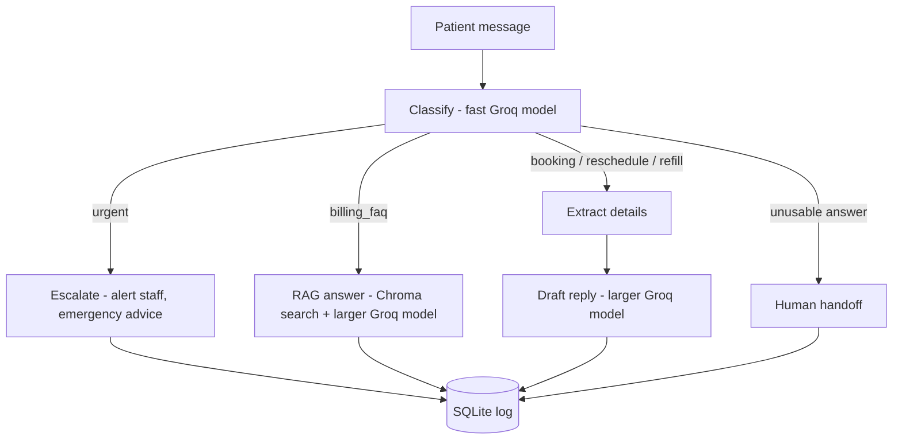

# ClinicFlow AI

**AI-powered triage automation for patient messages at a small clinic.**

Clinics receive a constant stream of messages: booking requests, cancellations, refill requests, simple questions, and sometimes messages describing a real emergency. ClinicFlow AI reads each message, decides what it is, and takes the right action. Routine requests get a drafted reply, simple questions are answered from the clinic's own information, and anything urgent is escalated to a human immediately.

> **Demo project. All data is synthetic.** The clinic ("Greenfield Family Clinic") and every patient message are fictional. This project does not give medical advice and must not be used with real patient data.

- **Demo video:** (add link)
- **Live demo:** (add link, if deployed)
- **Prompt documentation:** [docs/prompt_documentation.md](docs/prompt_documentation.md)

---

## What it does

1. **Classifies** each message as `booking`, `reschedule`, `billing_faq`, `refill`, or `urgent`.
2. **Extracts** structured details (name, preferred date/time, medication, symptoms) as JSON.
3. **Answers FAQs with RAG:** it looks up the relevant section of the clinic's information in a vector database and answers only from that text. If the answer isn't there, it says so and hands over to staff instead of guessing.
4. **Drafts replies** for bookings, reschedules, and refills, asking for any missing information. It never invents appointment times, fees, or policies, and never gives medical advice.
5. **Escalates urgent messages**: a calm message tells the patient to contact emergency services, a staff alert is created, and the case is flagged "human needed". Messages about self-harm get a warm, supportive response.
6. **Falls back safely:** if the classifier gives an unusable answer, the message goes to a human instead of the AI guessing.
7. **Logs everything** to a SQLite database and shows a dashboard.

## How it works



| Task | Model | Why |
|---|---|---|
| Classify, extract | Small, fast Groq model (`llama-3.1-8b-instant` by default) | Quick structured tasks with a clear right answer |
| FAQ answer, reply drafting, escalation | Larger Groq model (`llama-3.3-70b-versatile` by default) | Writing to patients needs better judgment |
| Embeddings (RAG) | Local model that ships with Chroma | No extra API key needed |

Model names are set in `.env`, so they can be changed without touching code.

## Tech stack

Python, FastAPI, LangGraph, LangChain, Groq, Chroma (vector database), Streamlit, SQLite, pandas.

## Project structure

```
clinicflow-ai/
  streamlit_app.py            Web interface (message tester + dashboard)
  requirements.txt
  .env.example                Template for your API key and settings
  app/
    config.py                 Settings and model connections
    prompts.py                All app prompts, stored by version (v1, v2, v3)
    rag.py                    Chroma vector search over the clinic FAQ
    state_and_llm_helpers.py  Workflow state and one helper per AI task
    graph.py                  LangGraph workflow and routing
    database.py               SQLite logging
    main.py                   FastAPI backend
    evaluate.py               Scores a prompt version against labelled messages
  data/
    clinic_faq.md             Synthetic clinic information (the RAG knowledge base)
    test_messages.json        36 labelled development messages
    heldout_messages.json     16 labelled messages never used to tune prompts
  docs/
    prompt_documentation.md   Every prompt used to build this project
  results/                    Saved evaluation results (CSV)
```

## Setup

**Requirements:** Python 3.10 or newer and a free [Groq API key](https://console.groq.com).

```
git clone <your-repo-url>
cd clinicflow-ai

python -m venv venv
venv\Scripts\activate          # Windows
source venv/bin/activate       # Mac / Linux

pip install -r requirements.txt
```

Create your settings file:

1. Copy `.env.example` to a new file named `.env`.
2. Open `.env` and put your real key in `GROQ_API_KEY`.

The `.env` file is ignored by Git, so your key is never uploaded.

> The first time the FAQ search runs, Chroma downloads a small embedding model (it needs an internet connection once). If you edit `data/clinic_faq.md`, rebuild the search index with `python -m app.rag --rebuild`.

## Run the app

Run these from the main `clinicflow-ai` folder with your virtual environment active.

**Simplest (one command):**

```
streamlit run streamlit_app.py
```

If no API server is found, the page runs the workflow directly ("all-in-one mode"). This is also how the live demo is hosted.

**With the separate API (two terminals):**

```
# Terminal 1: backend API
uvicorn app.main:app --reload

# Terminal 2: web interface
streamlit run streamlit_app.py
```

The page detects the running API and uses it ("API mode").

- The web page opens at http://localhost:8501.
- In API mode, the interactive API documentation is at http://127.0.0.1:8000/docs.
- Use the **Prompt version** selector in the sidebar to compare how v1, v2, and v3 handle the same message.

## Deploy the live demo (Streamlit Community Cloud)

1. Push the repository to GitHub (the `.env` file is ignored, so your key is not uploaded).
2. On [share.streamlit.io](https://share.streamlit.io), create an app from the repository with `streamlit_app.py` as the main file.
3. In the app's **Settings, Secrets**, add your key at the top level:
   ```
   GROQ_API_KEY = "your-real-key"
   ```
4. Open the app. The first FAQ question is slow because the search model is downloaded and the FAQ is indexed once.

The demo's message history is not permanent: free hosting resets local files when the app restarts.

## Evaluation

The classifier is scored against labelled messages. The development set (36 messages) guided the prompt changes. The held-out set (16 messages) was written afterwards, never used for tuning, and run once.

```
python -m app.evaluate --version v3      # development set
python -m app.evaluate --heldout         # held-out set
```

| Prompt version | Development set (36) | Urgent caught | Notes |
|---|---|---|---|
| v1 (simple baseline) | 32/36 = 88.9% | 7/8 | Missed an understated urgent message; mistook general clinic questions for bookings |
| v2 (definitions, safety-first rule, examples) | 35/36 and 34/36 in two runs | 8/8 | Fixed v1's failures, but messages starting with "Please" sometimes got an unusable reply |
| v3 (patient text wrapped in tags) | 36/36 = 100% | 8/8 | Fixed the "Please" problem |

**Held-out set (v3, run once):** 16/16 = 100%, urgent caught 4/4, no false urgent alarms.

Results for each run are saved in `results/` as CSV files that include the model's raw reply for every message. The full story of how each prompt version was developed is in the [prompt documentation](docs/prompt_documentation.md).

## Safety design

- **Safety first:** the classifier is told that if a message could be urgent, it must choose urgent, even when the patient downplays it or only asks for an appointment. A counter-rule keeps mild symptoms from causing false alarms (0 false urgent alarms in testing).
- **No medical advice:** every writing prompt forbids diagnoses and treatment advice. Urgent replies only direct the patient to emergency help.
- **No guessing:** FAQ answers must come from the clinic information, and unclear classifications go to a human.
- **Patient text is treated as data, not instructions:** messages are wrapped in tags so text like "Please..." or "ignore my last email" is not mistaken for a command to the AI.
- **Synthetic data only**, with the local database and vector index excluded from Git.

## Limitations

- The test sets are small, and the evaluation scores **classification only**. Reply quality was checked by reading replies for sample messages, not scored automatically.
- Language models can vary between runs, so a score on one run is not a guarantee. Re-run the evaluation to check stability.
- Model names on Groq can change over time. If a model stops working, update the model names in `.env`.
- This is a prototype. A real clinic deployment would need privacy and compliance work, authentication, clinical review of the escalation rules, and monitoring.

## Built with AI

Claude was used throughout development to plan the project, write and explain the code, and iterate on the prompts, and the Groq models power the app itself. Every prompt used during development, including corrections and follow-ups, is recorded in [docs/prompt_documentation.md](docs/prompt_documentation.md).
